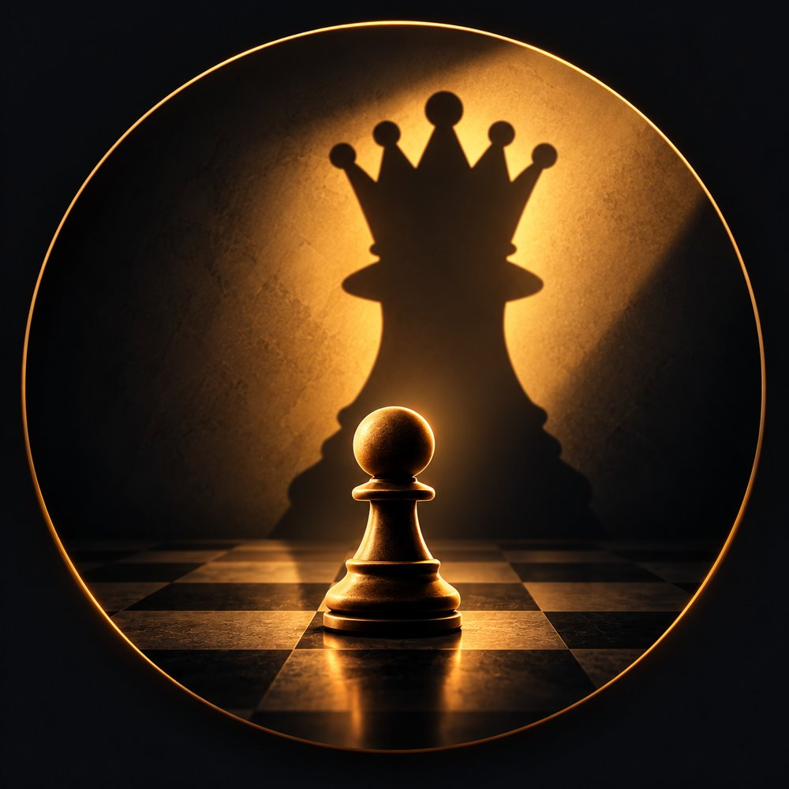

# CHESS

<p align="center"></p>

A local two-player chess game: board graphics, animated piece moves, the full rules of chess, undo, and
saving a game as PGN for review with chess engines. No network, no accounts, no AI - two people, one
device, taking turns.

The same game is built in several technology stacks, one folder each, so they can be compared:

| Folder | Stack | Platforms | Status |
|---|---|---|---|
| [`cpp/`](cpp/) | C++17 + SDL2 | Windows now; Linux/macOS likely; Android/iOS prepared | **Playable**, all tests pass |
| [`flutter/`](flutter/) | Flutter / Dart | Windows and web built; Android/iOS prepared | **Playable**, 73 tests pass |
| [`godot/`](godot/) | Godot / GDScript | Desktop, Android, iOS | Planned |

## Project structure
```
CHESS/
├── Readme.MD        this file
├── docs/
│   ├── PLAN.md      the implementation plan and a progress record (what is done, what is next)
│   ├── RULES.md     rules every implementation must follow
│   ├── UI_SPEC.md   how the game looks and behaves, shared by all stacks
│   ├── THEMES.md    board colours, piece sets and interface palettes, shared by all stacks
│   ├── logo/        logo artwork, icon SVGs and how the icons are produced
│   └── testdata/    perft.json, scenarios.json, pgn.json - shared tests every stack must pass
├── tools/           make_icons.py: builds all app icons from the logo SVG
├── cpp/             C++ implementation (rules library, tests, SDL2 app) - see cpp/README.md
├── flutter/         Flutter implementation - see flutter/README.md
└── godot/           Godot implementation - see godot/README.md
```
Each stack is self-contained: its own rules code, build and tests. They only share the documents and test
data in `docs/`, which is what keeps them consistent.

## Run it

### C++ (Windows)
Needs Visual Studio 2022 Build Tools with "Desktop development with C++", Git, and internet on first build.
```powershell
powershell -ExecutionPolicy Bypass -File cpp\build.ps1 -Test   # build and run the rules tests
powershell -ExecutionPolicy Bypass -File cpp\build.ps1 -Run    # build and start the game
```
Afterwards `build\app\chess.exe` starts the game directly. Details, folder structure, Linux/macOS and mobile
notes: [`cpp/README.md`](cpp/README.md).

### Flutter
Needs the Flutter SDK (3.47+) on PATH; Windows desktop also needs Visual Studio's C++ workload.
```powershell
cd flutter
flutter pub get
flutter test               # shared rules data + UI interaction tests
flutter run -d windows     # or -d chrome, or an Android device/emulator
```
Details, folder structure and per-platform notes: [`flutter/README.md`](flutter/README.md).

### Godot
Not implemented yet. Planned: open `godot/` in Godot 4 and press F5, or `godot --path godot`.
See [`godot/README.md`](godot/README.md).

## How to play
Click a piece and then one of the highlighted squares, or drag the piece. Pawns reaching the far side open a
promotion picker. Side panel: **New Game**, **Undo**, **Save PGN**, **Copy FEN**, **Flip** (turns the board
towards whoever is to move), **Themes** (board colours, piece sets, interface palettes; saved between runs).

### Reviewing a game with an engine
Press **Save PGN** at any time and choose where to put the file. Import it into
[Lichess](https://lichess.org/paste) (analysis board, Stockfish built in), Chess.com, or a desktop GUI such as
Arena or Scid with Stockfish. **Copy FEN** copies the current position if you only want to analyse that.

## Documentation
- [`docs/PLAN.md`](docs/PLAN.md) - plan and progress record
- [`docs/RULES.md`](docs/RULES.md) - rules checklist
- [`docs/UI_SPEC.md`](docs/UI_SPEC.md) - UI and animation spec
- [`docs/THEMES.md`](docs/THEMES.md) - themes shared by all stacks
- [`docs/logo/README.md`](docs/logo/README.md) - logo, where the icon is used, and the Halloween edition
