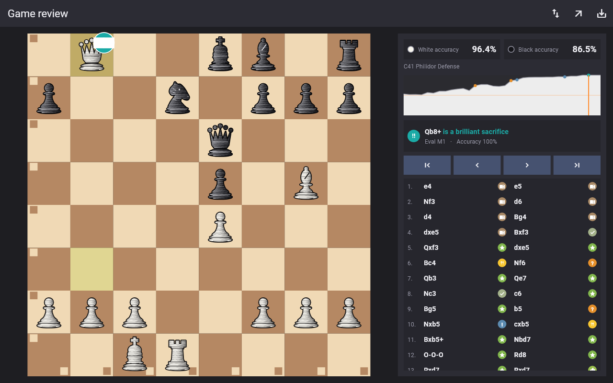

# CHESS

<p align="center"></p>

A local two-player chess game: board graphics, animated piece moves, the full rules of chess, undo, and
saving a game as PGN for review with chess engines. No network, no accounts, no AI - two people, one
device, taking turns.

The same game is built in several technology stacks, one folder each, so they can be compared:

| Folder | Stack | Platforms | Status |
|---|---|---|---|
| [`cpp/`](cpp/) | C++17 + SDL2 | Windows now; Linux/macOS likely; Android/iOS prepared | **Playable**, game review, 8 test groups pass |
| [`flutter/`](flutter/) | Flutter / Dart | Windows and web built; Android/iOS prepared | **Playable**, game review (Windows), 164 tests pass |
| [`godot/`](godot/) | Godot / GDScript | Desktop, Android, iOS | Planned |

## Project structure
```
CHESS/
├── Readme.MD        this file
├── docs/
│   ├── PLAN.md      the implementation plan and a progress record (what is done, what is next)
│   ├── RULES.md     rules every implementation must follow
│   ├── UI_SPEC.md   how the game looks and behaves, shared by all stacks
│   ├── THEMES.md    board colours, piece sets and interface palettes, shared by all stacks
│   ├── REVIEW.md    how the game review scores and labels moves, shared by all stacks
│   ├── PLAN_REVIEW.md  plan and progress record of the game review
│   ├── data/        openings.tsv (Lichess chess-openings, CC0)
│   ├── screenshots/ pictures of the review screen
│   ├── logo/        logo artwork, icon SVGs and how the icons are produced
│   └── testdata/    perft.json, scenarios.json, pgn.json, review.json - shared tests every stack must pass
├── tools/           make_icons.py (app icons), run_tests.ps1 (all tests, used by the push hook),
│                    get_stockfish.ps1 (downloads Stockfish), gen_review_testdata.py (reference for review.json)
├── engine/          Stockfish binary after get_stockfish.ps1 (git-ignored)
├── .githooks/       pre-push: runs the tests before a push
├── cpp/             C++ implementation (rules library, tests, SDL2 app) - see cpp/README.md
├── flutter/         Flutter implementation - see flutter/README.md
└── godot/           Godot implementation - see godot/README.md
```
Each stack is self-contained: its own rules code, build and tests. They only share the documents and test
data in `docs/`, which is what keeps them consistent.

## Run it

### C++ (Windows)
Needs Visual Studio 2022 Build Tools with "Desktop development with C++", Git, and internet on first build.
```powershell
powershell -ExecutionPolicy Bypass -File cpp\build.ps1 -Test   # build and run the rules tests
powershell -ExecutionPolicy Bypass -File cpp\build.ps1 -Run    # build and start the game
```
Afterwards `build\app\chess.exe` starts the game directly. Details, folder structure, Linux/macOS and mobile
notes: [`cpp/README.md`](cpp/README.md).

### Flutter
Needs the Flutter SDK (3.47+) on PATH; Windows desktop also needs Visual Studio's C++ workload.
```powershell
cd flutter
flutter pub get
flutter test               # shared rules data + UI interaction tests
flutter run -d windows     # or -d chrome, or an Android device/emulator
```
Details, folder structure and per-platform notes: [`flutter/README.md`](flutter/README.md).

### Godot
Not implemented yet. Planned: open `godot/` in Godot 4 and press F5, or `godot --path godot`.
See [`godot/README.md`](godot/README.md).

## How to play
Click a piece and then one of the highlighted squares, or drag the piece. Pawns reaching the far side open a
promotion picker. Side panel: **New Game**, **Undo**, **Save PGN**, **Copy FEN**, **Flip** (turns the board
towards whoever is to move), **Themes** (board colours, piece sets, interface palettes; saved between runs).

### Reviewing a game with an engine
Press **Save PGN** at any time and choose where to put the file. Import it into
[Lichess](https://lichess.org/paste) (analysis board, Stockfish built in), Chess.com, or a desktop GUI such as
Arena or Scid with Stockfish. **Copy FEN** copies the current position if you only want to analyse that.

## Tests before every push
A git hook runs the existing tests before `git push` and cancels the push if one fails. It only tests what
changed: C++ for `cpp/`, Flutter for `flutter/`, both when `docs/testdata/` changes. Enable it once per clone:
```
git config core.hooksPath .githooks
```
Run the same checks by hand with `powershell -ExecutionPolicy Bypass -File tools
un_tests.ps1 [-Cpp] [-Flutter]`
(about 3 minutes for both). Skip once with `SKIP_PUSH_TESTS=1 git push` or `git push --no-verify`.

## Game review (Stockfish)
Both apps can **review a game** like chess.com: every move is labelled Brilliant, Great, Best, Excellent, Good, Book,
Inaccuracy, Mistake, Miss or Blunder, with accuracy per player, an evaluation graph, the opening and the engine's
preferred move. The analysis is done by [Stockfish](https://stockfishchess.org/) (a separate GPLv3 program, not stored in
this repository):
```powershell
powershell -ExecutionPolicy Bypass -File tools\get_stockfish.ps1    # downloads and verifies engine\stockfish.exe
```
Then press **REVIEW** in either app, or open a saved `.pgn`. Phones and the browser cannot launch a separate engine
program yet, so the review is Windows-only for now. How the labels are decided: [`docs/REVIEW.md`](docs/REVIEW.md).



## Documentation
- [`docs/PLAN.md`](docs/PLAN.md) - plan and progress record
- [`docs/RULES.md`](docs/RULES.md) - rules checklist
- [`docs/UI_SPEC.md`](docs/UI_SPEC.md) - UI and animation spec
- [`docs/THEMES.md`](docs/THEMES.md) - themes shared by all stacks
- [`docs/REVIEW.md`](docs/REVIEW.md) - how the game review labels moves; [`docs/PLAN_REVIEW.md`](docs/PLAN_REVIEW.md) - its plan and progress
- [`docs/logo/README.md`](docs/logo/README.md) - logo, where the icon is used, and the Halloween edition
